---
## Author
author:
  name: Зорова Ульяна Владимировна 
  group: НФИбд-02-26 
  email: 1132260180@rudn.ru 
  affiliation:
    - name: Российский университет дружбы народов
      country: Российская Федерация
      city: Москва
      address: ул. Миклухо-Маклая, д. 6

## Title
title: "Отчет по лабораторной работе 5"
subtitle: "Приобретение практических навыков работы в Midnight Commander. Освоение инструкций языка ассемблера mov и int"
license: "CC BY"
abstract: |
  В данном отчете я описала ход выполнения лабораторной работы №5, в рамках которой освоила работу в среде Midnight Commander и изучила базовые инструкции ассемблера mov и int.

keywords: [лабораторная работа, ассемблер, NASM, Midnight Commander]
---

# Цель работы

Приобретение практических навыков работы в Midnight Commander. Освоение инструкций языка ассемблера mov и int

# Выполнение лабораторной работы

**Особенность выполнения:** Работа выполнялась в среде Ubuntu, в виртуальной машине UTM на базе процессора Apple Silicon (архитектура ARM64). Поскольку стандартный компоновщик `ld` не поддерживает генерацию 32-битных, применялся кросс-линковщик `i686-linux-gnu-ld`. Запуск полученных файлов осуществлялся через эмулятор `qemu-i386`.

Сначала я запустила Midnight Commander (@fig-1).

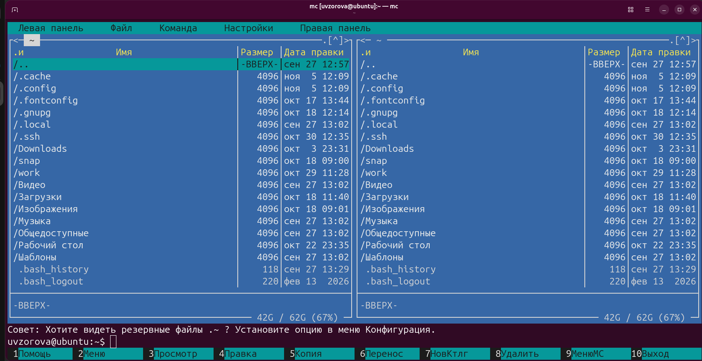{#fig-1 width=80%}

Затем с помощью клавиш навигации я перешла в каталог `~/work/arch-pc`, где создала папку для текущей лабораторной работы — `lab05` (@fig-2).

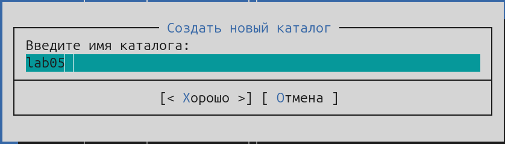{#fig-2 width=80%}

Далее я создала файл `lab5-1.asm` (@fig-3).

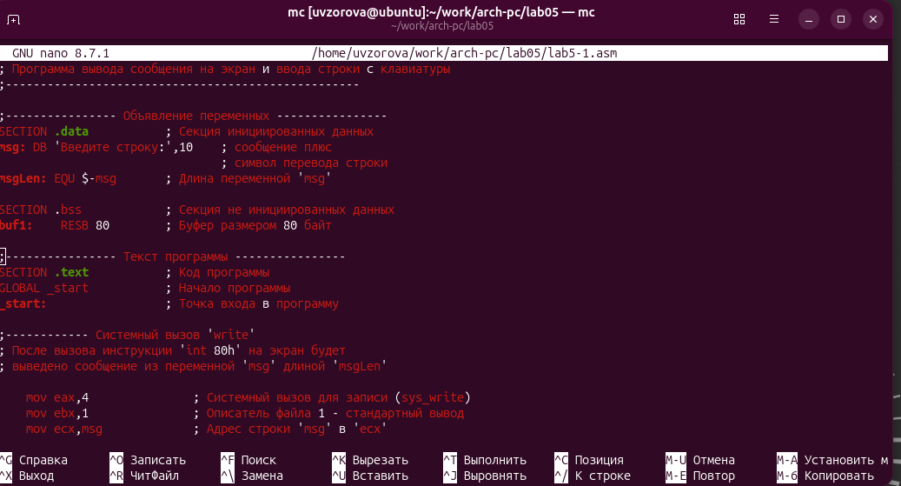{#fig-3 width=80%}

Для его редактирования использовала встроенный редактор, в который скопировала код из первого листинга методических указаний (@fig-4).

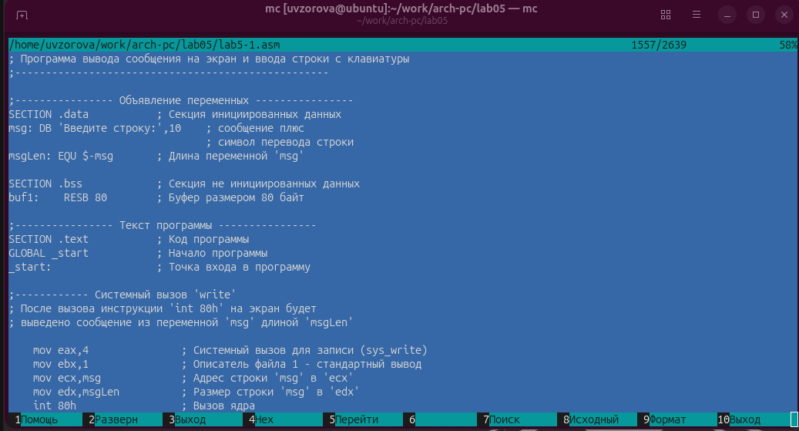{#fig-4 width=80%}

Для проверки работоспособности программы выполнила: трансляцию исходного файла, его компоновку в исполняемый файл и запуск (@fig-5).

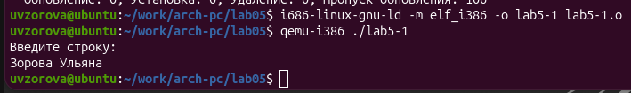{#fig-5 width=80%}

## Подключение внешнего файла in_out.asm

Далее я скачала файл in_out.asm со страницы курса в ТУИС. Переместила файл в каталог `lab05` (@fig-6).

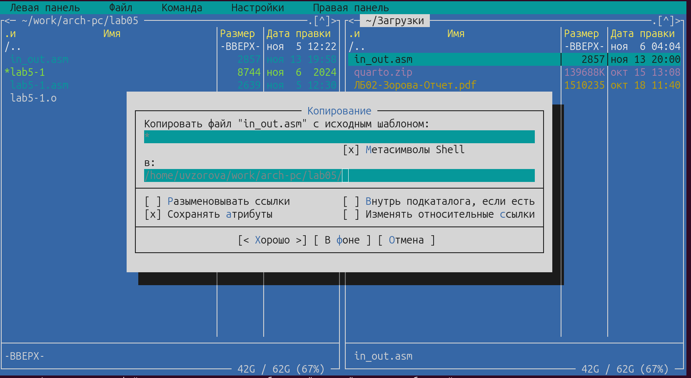{#fig-6 width=80%}

Далее я создала копию файла lab5-1.asm, назвав её lab5-2.asm (@fig-7).

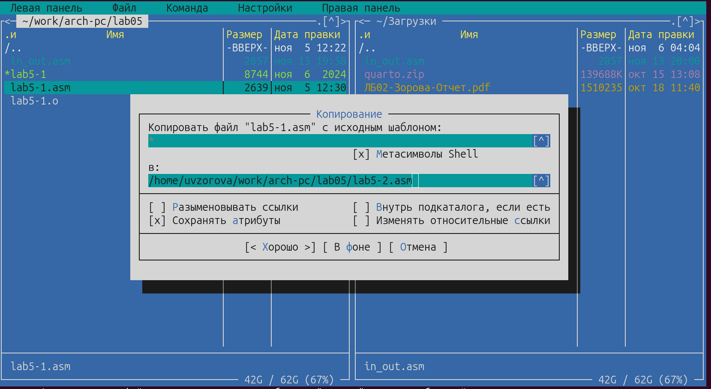{#fig-7 width=80%}

Я изменила код в файле lab5-2.asm, применив функции из внешнего модуля in_out.asm (@fig-8).

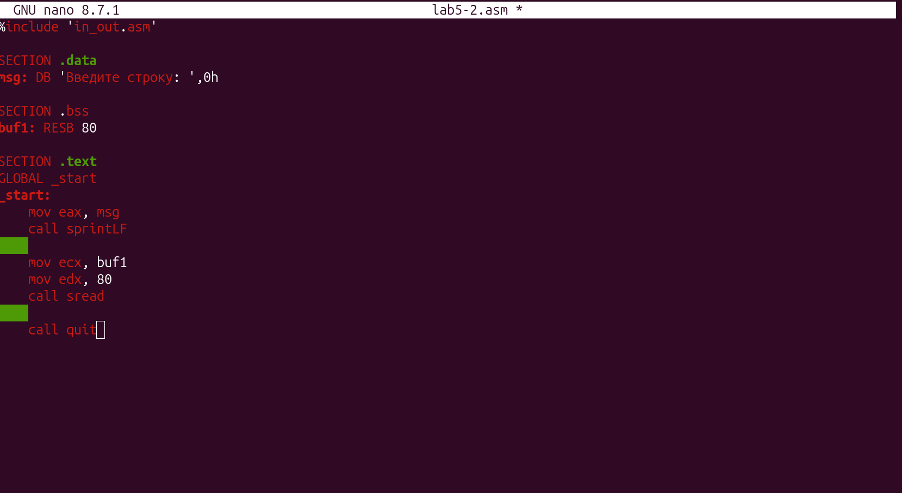{#fig-8 width=80%}

После трансляции и компоновки я запустила программу. Она отработала корректно (@fig-9).

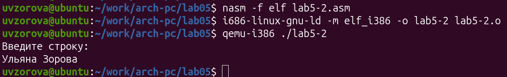{#fig-9 width=80%}

Затем я отредактировала файл lab5-2.asm, заменив подпрограмму sprintLF на sprint. После этого я заново скомпилировала программу и запустила её для проверки (@fig-10).

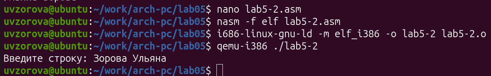{#fig-10 width=80%}

При проверке я увидела, что sprintLF переносит курсор на следующую строку после вывода приглашения, а sprint оставляет его на месте, поэтому ввод данных происходит в той же строке.

# Выполнение самостоятельной работы

## Программа без использования внешнего файла in_out.asm

Для начала я создала копию исходного файла lab5-1.asm и переименовала её в lab5-1-copy.asm, оставив в той же рабочей папке (@fig-11).

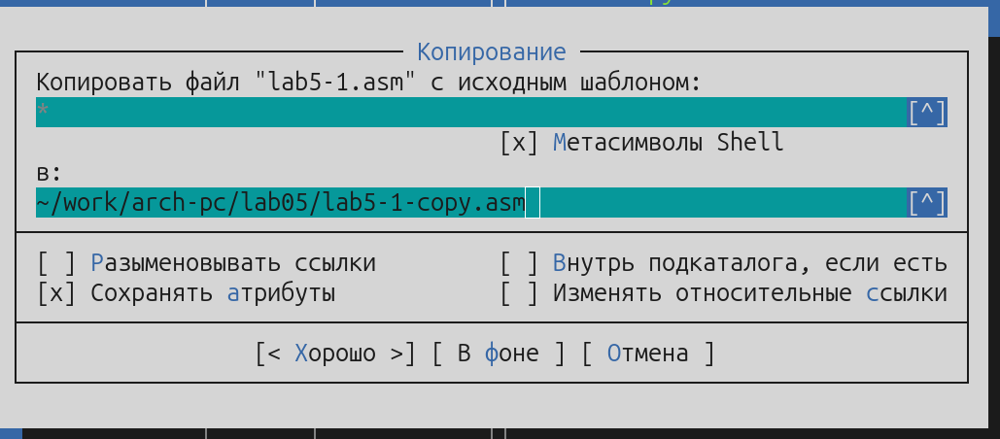{#fig-11 width=80%}

Далее я внесла изменения в исходный файл, добавив блок кода, который отвечает за вывод введенной пользователем строки обратно на экран. Для этого я дополнила программу следующим фрагментом (@fig-12).

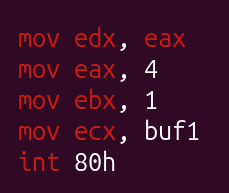{#fig-12 width=80%}

В коде ввода команда mov eax, 3 вызывает функцию sys_read. После её выполнения в eax оказывается длина введенного текста. Я передаю эту длину в регистр edx, чтобы функция sys_write (команда mov eax, 4) знала, сколько байт необходимо вывести на экран. Далее я скомпилировала и запустила программу для проверки.

Работа программы прошла успешно: введенная строка корректно отобразилась на экране (@fig-13).

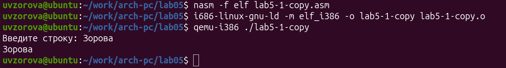{#fig-13 width=80%}

## Программа с использованием внешнего файла in_out.asm

Далее я сделала копию файла lab5-2.asm и назвала её lab5-2-copy.asm. В новом файле я добавила вывод введенного текста на экран, используя уже готовые подпрограммы из внешнего файла in_out.asm (@fig-14).

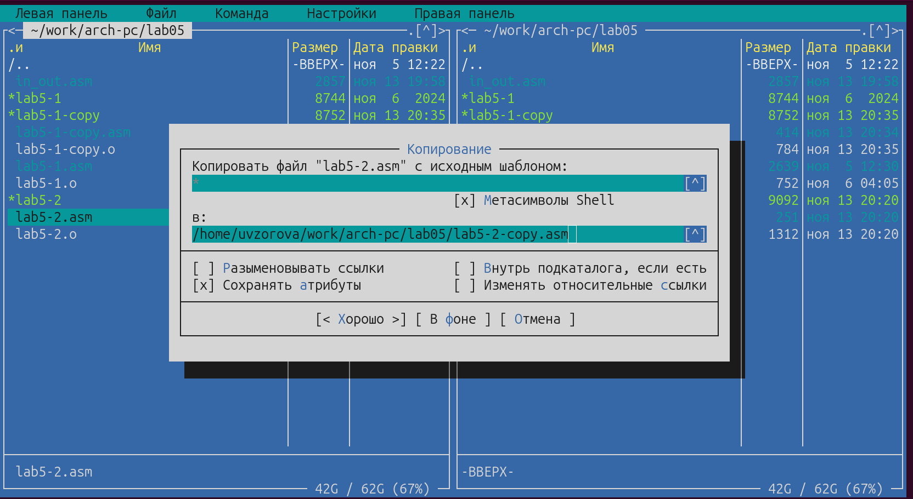{#fig-14 width=80%}

Я добавила вывод введенной строки, применив функцию sprint. Для этого я добавила адрес буфера в регистр eax (@fig-15).

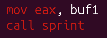{#fig-15 width=50%}

В результате компиляции и запуска программа отработала без ошибок: она вывела приглашение, приняла введенную мной строку и сразу же отобразила её на экране. Это подтверждает, что подключение внешнего файла in_out.asm было выполнено корректно (@fig-16).

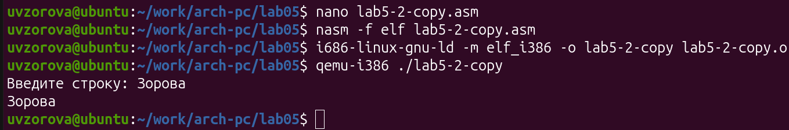{#fig-16 width=80%}

# Вывод

В ходе выполнения лабораторной работы я приобрела практические навыки работы в файловом менеджере Midnight Commander, а также освоила базовые инструкции языка ассемблера mov и int.
