---
## Author
author:
  name: Зорова Ульяна Владимировна
  group: НФИбд-02-26
  email: 1132260180@rudn.ru
  affiliation:
    - name: Российский университет дружбы народов
      country: Российская Федерация
      city: Москва
      address: ул. Орджоникидзе, д. 3

## Title
title: "Отчет по лабораторной работе 2"
subtitle: "Система контроля версий Git"
license: "CC BY"
fig-prefix: "Рис."
---

# Цель работы

Целью работы является изучение идеологии и применения средств контроля версий, приобретение практических навыков по работе с системой контроля версий git.

# Задание

Изучить базовые команды системы контроля версий Git на основе методических материалов, освоить сценарии их применения в различных ситуациях и выполнить первичную настройку учетной записи на GitHub.

# Техническое обеспечение

Для выполнения лабораторной работы я использовала домашний ноутбук Apple MacBook на процессоре Apple Silicon с виртуальной машиной Ubuntu Linux, запущенной через приложение UTM, а также встроенный терминал, систему контроля версий Git и платформы Git (включая удаленный репозиторий на GitHub).

# Выполнение лабораторной работы

## Настройка GitHub

1) Захожу на сайт GitHub, авторизовываюсь там и заполняю основные данные.

## Базовая настройка git

1) Начинаю с предварительной конфигурации git. Открываю терминал и ввожу команды, указывая свое имя и свой адрес эл.почты (@fig-1).

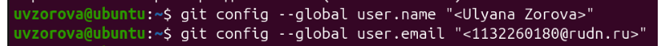{#fig-1 width=80%}

2) Настраиваю utf-8, имя начальной ветки, параметр autocrlf, параметр safecrlf (@fig-2).

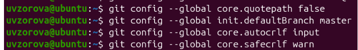{#fig-2 width=80%}

3) Создаю SSH-ключ (пару ключей) для идентификации на сервере репозиториев (@fig-3).

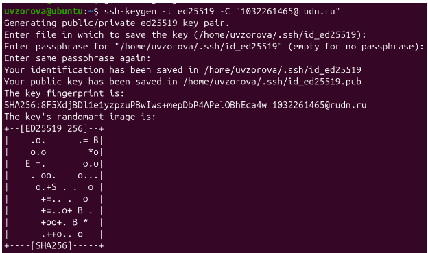{#fig-3 width=80%}

4) Перехожу на сайт GitHub, в настройках выбираю вкладку Ключи SSH/GPG, добавляю созданный ключ (@fig-4).

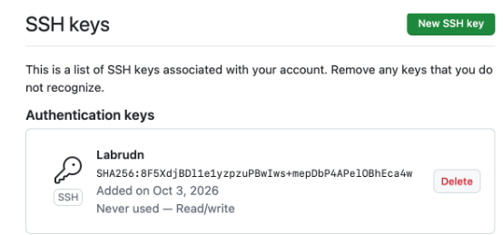{#fig-4 width=80%}

## Создание рабочего пространства и репозитория курса

1) Создаю структуру рабочих каталогов для учебных материалов (@fig-5).

{#fig-5 width=80%}

## Создание репозитория курса на основе шаблона

1) Создаю репозиторий на основе имеющегося шаблона в GitVerse (@fig-6, @fig-7).

{#fig-6 width=80%}

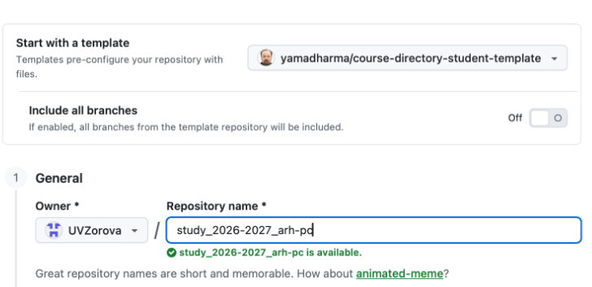{#fig-7 width=80%}

2) Клонирую созданный репозиторий с шаблоном курса с помощью интерфейса GitHub. И копирую ссылку (@fig-8).

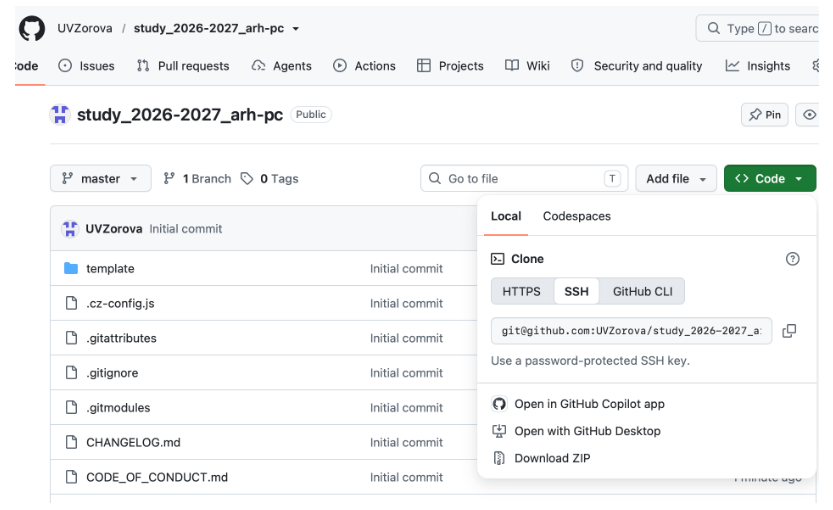{#fig-8 width=80%}

3) Скопированную ссылку на созданный репозиторий вставляю в терминал (@fig-9).

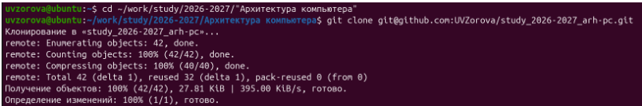{#fig-9 width=80%}

## Настройка каталога курса

1) Перехожу в каталог курса, создаю необходимые каталоги и отправляю файлы на сервер (@fig-10).

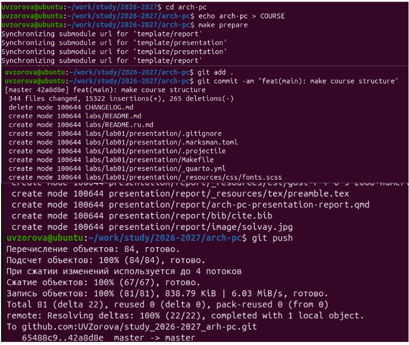{#fig-10 width=80%}

2) Захожу в репозиторий в GitHub и проверяю правильность создания иерархии рабочего пространства (@fig-11).

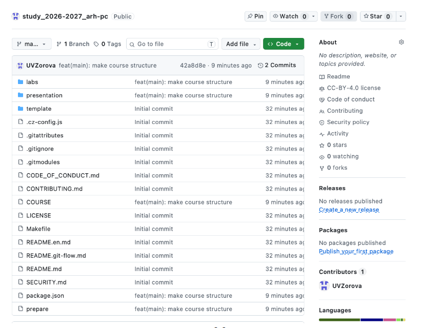{#fig-11 width=80%}

3) Создаю отчёт по выполнению лабораторной работы, копирую отчёт по выполнению первой лабораторной работы, и загружаю файл в свой репозиторий (@fig-12).

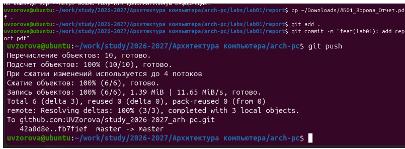{#fig-12 width=80%}

4) Проверяю корректность выполненных действий на GitHub (@fig-13).

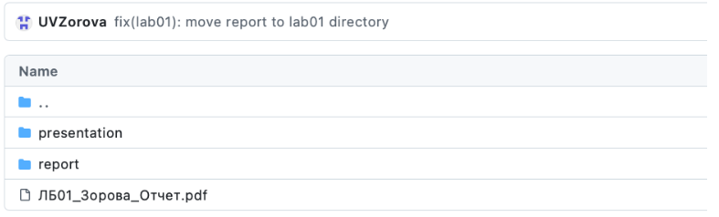{#fig-13 width=80%}

# Вывод

В ходе выполнения работы были успешно изучены основные принципы идеологии систем контроля версий и приобретены практические навыки работы с Git. На практике освоены базовые команды и сценарии их применения для управления версиями исходного кода, а также выполнена необходимая настройка для работы с удаленным репозиторием на GitHub.
