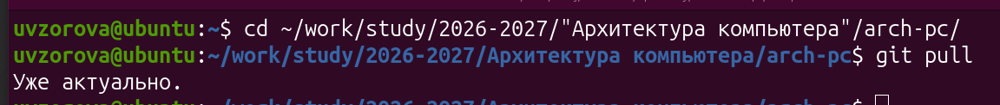
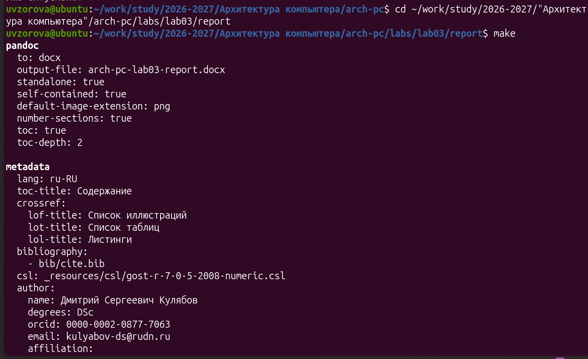
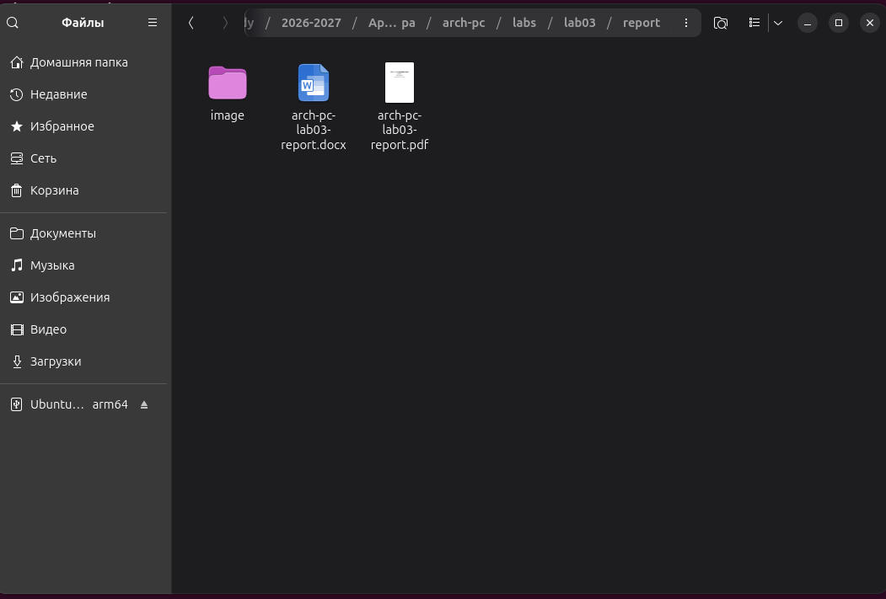
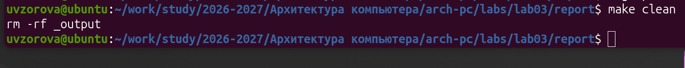
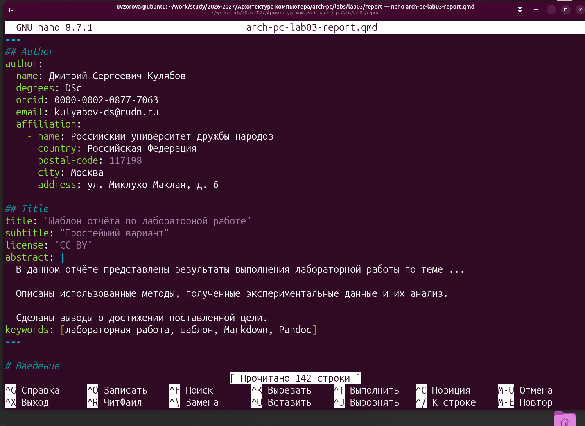
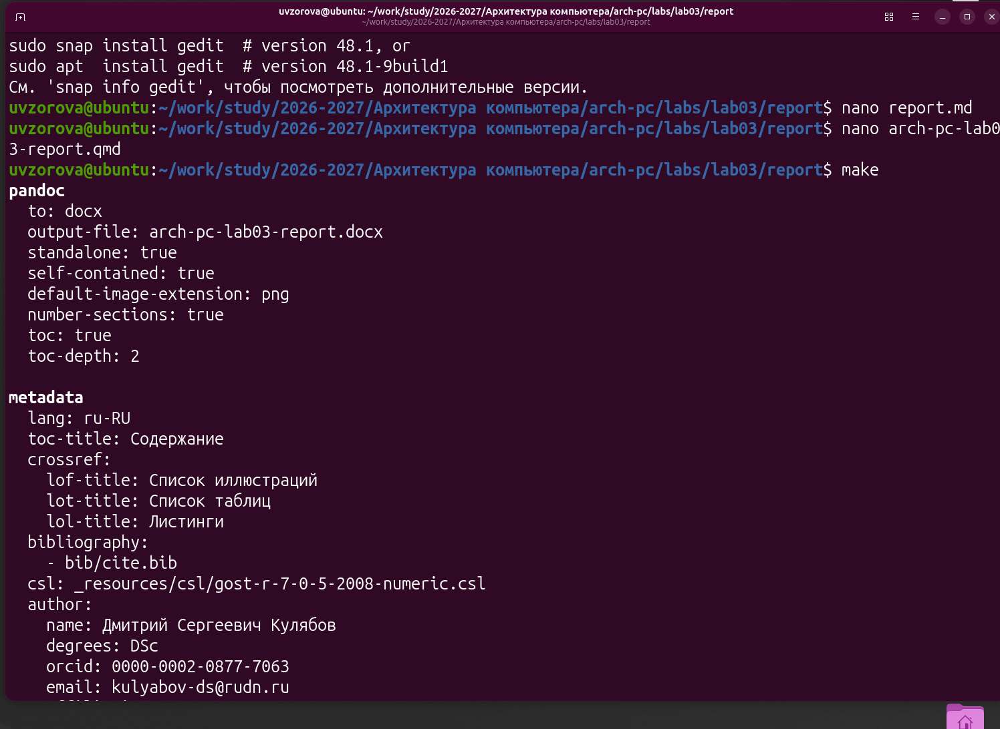
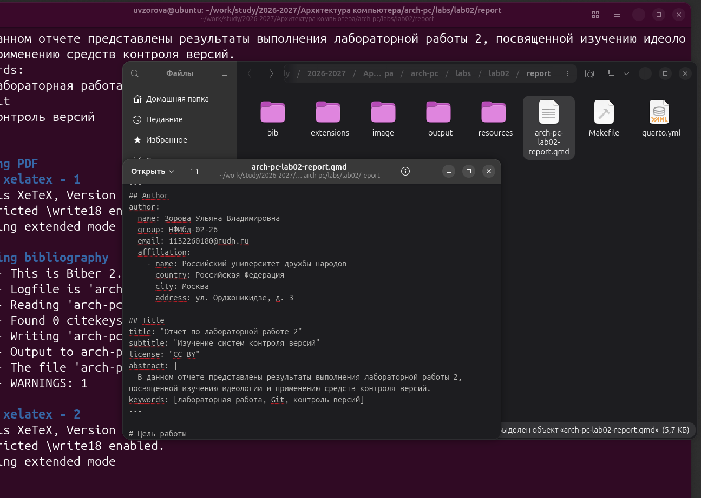

---
## Author
author:
  name: Зорова Ульяна Владимировна
  group: НФИбд-02-26
  email: 1132260180@rudn.ru
  affiliation:
    - name: Российский университет дружбы народов
      country: Российская Федерация
      city: Москва
      address: ул. Орджоникидзе, д. 3

## Title
title: "Отчет по лабораторной работе 3"
subtitle: "Язык разметки Markdown"
license: "CC BY"
abstract: |
  В данном документе приведены итоги выполнения лабораторной работы 3, направленной на изучение процесса формирования отчетов с применением облегченного языка разметки Markdown.

keywords: [лабораторная работа, шаблон, Markdown, Pandoc]
---

# Цель работы

Изучить и применить на практике процедуру оформления отчетов с помощью облегченного языка разметки Markdown.

# Выполнение лабораторной работы

Я запустила терминал, переместилась в каталог учебного курса (созданный на этапе второй лабораторной работы) и обновила локальную копию репозитория с помощью команды git pull (@fig-1)

{#fig-1 width=80%}

Затем я перешла в папку с отчетом по третьей лабораторной работе и запустила компиляцию шаблона, используя Makefile и команду make (@fig-2)

{#fig-2 width=80%}

В результате выполнения команды были созданы файлы arch-pc-lab03-report.docx и arch-pc-lab03-report.pdf (@fig-3)

{#fig-3 width=80%}

Затем я удалила эти сгенерированные файлы с помощью команды make clean (@fig-4)

{#fig-4 width=80%}

После этого я открыла исходный файл arch-pc-lab03-report.qmd и детально изучила его структуру (@fig-5)

{#fig-5 width=80%}

Опираясь на изученный шаблон arch-pc-lab03-report.qmd, я сформировала собственный отчет по лабораторной работе 3. С помощью команды make я заново сгенерировала файлы arch-pc-lab03-report.docx и arch-pc-lab03-report.pdf, но уже с моим текстом (@fig-6)

{#fig-6 width=80%}

Далее я загрузила готовые файлы на gitverse. Для этого в терминале были последовательно введены команды git add ., git commit -am 'feat(main): add files lab-3', git push

# Выполнение самостоятельной работы

В каталоге labs/lab02/report я создала отчет по второй лабораторной работе в трех форматах: .pdf, .docx, .md, после чего также загрузила их на gitverse (@fig-7)

{#fig-7 width=80%}

Ссылка на мой репозиторий: [Gitverse Зорова Ульяна](https://github.com/UVZorova/study_2026-2027_arh-pc)

# Вывод

В ходе выполнения работы я освоила процедуры оформления отчетов с использованием легковесного языка разметки Markdown.
