---
## Author
author:
  name: Зорова Ульяна Владимировна
  group: НФИбд-02-26  
  email: 1132260180@rudn.ru 
  affiliation:
    - name: Российский университет дружбы народов
      country: Российская Федерация
      city: Москва
      address: ул. Миклухо-Маклая, д. 6

## Title
title: "Отчет по лабораторной работе 4"
subtitle: "Создание и процесс обработки программ на языке ассемблера NASM"
license: "CC BY"
abstract: |
  В данном документе описаны этапы выполнения четвертой лабораторной работы. В процессе работы я научилась писать простые программы на ассемблере NASM, а также изучила особенности работы транслятора и компоновщика в среде Linux.

keywords: [лабораторная работа, ассемблер, компиляция]
---

# Цель работы

Освоение процедуры компиляции и сборки программ, написанных на ассемблере
NASM.
# Выполнение лабораторной работы

## Программа Hello world!

Сначала  я открыла терминал и сформировала рабочую директорию для хранения файлов текущего проекта с помощью `mkdir` (@fig-1).

{#fig-1 width=80%}

Затем, перейдя в новую папку, я сгенерировала пустой текстовый документ, дав ему название `hello.asm` (@fig-2).

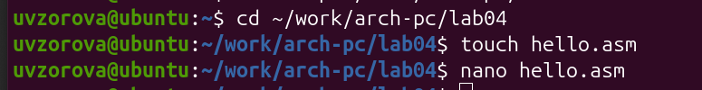{#fig-2 width=80%}

С помощью текстового редактора я открыла этот файл и набрала в нем исходный код первой программы (@fig-3).

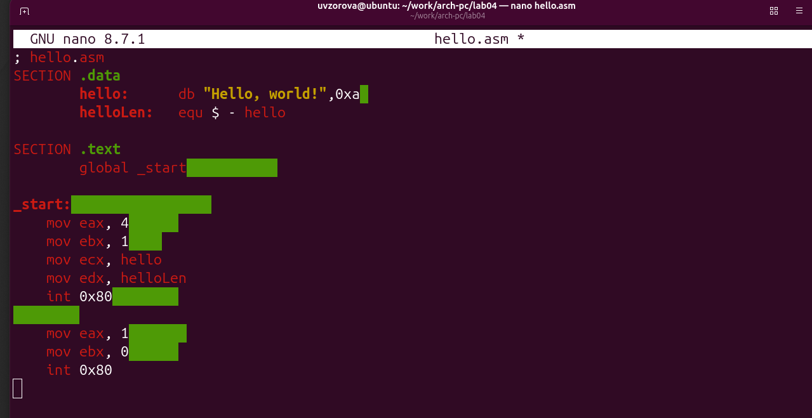{#fig-3 width=80%}

## Транслятор NASM

Для компиляции программы, я задействовала транслятор NASM, а точнее команду  `-f elf hello.asm `. После выполнения команды в директории появился файл `hello.o` (@fig-4).

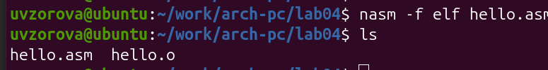{#fig-4 width=80%}

## Расширенный синтаксис командной строки NASM

Затем я использовала  расширенный синтаксис, скомпилировала файл 'hello.asm' в `obj.o` и создала листинг `list.lst`. Используя команду `ls`, я проверила, что все требуемые файлы успешно сформированы (@fig-5).

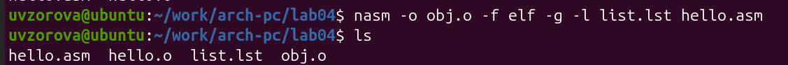{#fig-5 width=80%}

## Компоновщик LD

>  *Так как моя лабораторная работа выполняется на компьютере Mac, оснащенном процессором Apple Silicon (архитектура ARM), команда `ld` не поддерживается. По этой причине я применяла кросс-компилятор `i686-linux-gnu-ld`, а для запуска использовала пакет `qemu-user-binfmt`, который эмулирует необходимую архитектуру.*

Далее я отправила файл на обработку компоновщику. Проверка через `ls` показала, что исполняемый файл `hello` был создан корректно (@fig-6).

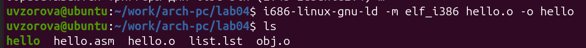{#fig-6 width=80%}

Затем я собрала второй объектный файл, указав в качестве выходного имени `main` (@fig-7). В результате объектный файл `obj.o` был преобразован в исполняемый файл `main`.

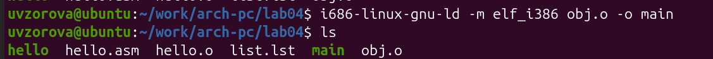{#fig-7 width=80%}

## Запуск исполняемого файла

Далее я запустила программу с помощью команды ./hello . В консоли появилась строка `Hello world!` (@fig-8).

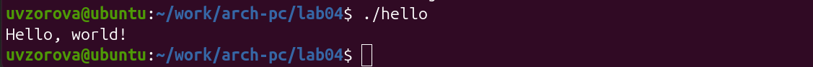{#fig-8 width=80%}

# Задание для самостоятельной работы

Для выполнения самостоятельной работы я сделала копию файла с помощью команды `cp` и переименовала копию в `lab4.asm` (@fig-9).

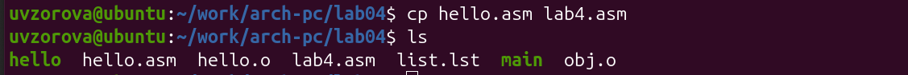{#fig-9 width=80%}

Внутри нового файла я внесла изменения, заменив приветствие на свое ФИО: «Зорова Ульяна Владимировна» (@fig-10).

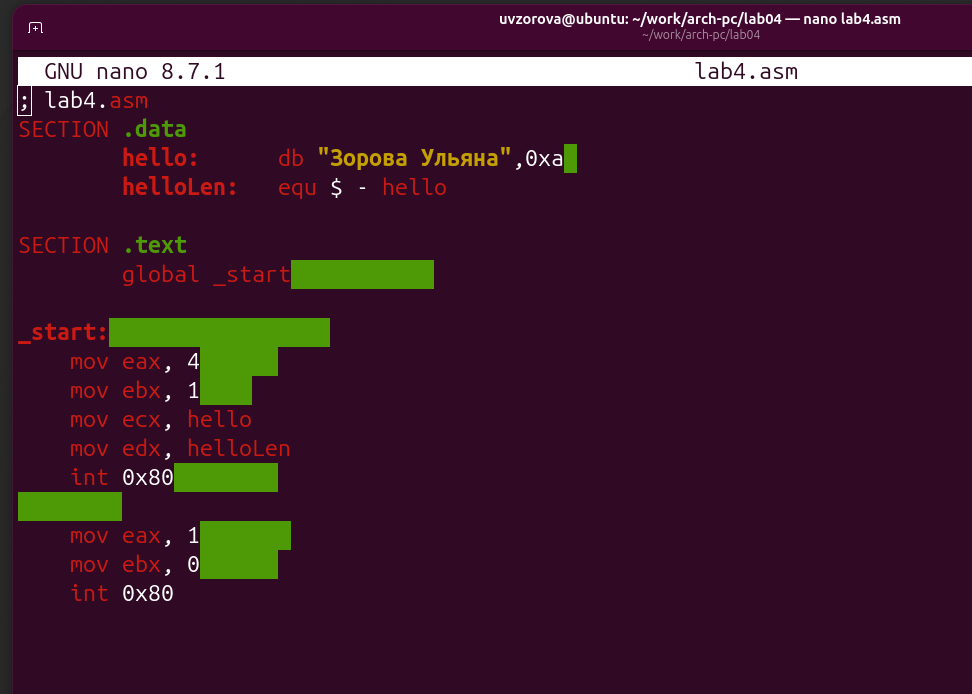{#fig-10 width=80%}

После сохранения изменений я выполнила трансляцию (создав `obj_lab4.o`) и компоновку (создав файл `lab4`). При запуске программа успешно вывела мое ФИО (@fig-11).

{#fig-11 width=80%}

Далее я скопировала файлы  (`hello.asm` и `lab4.asm`) в локальную папку репозитория (@fig-12).

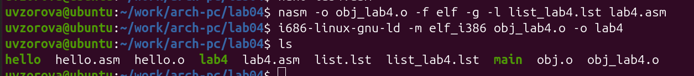{#fig-12 width=80%}

Далее я отправила файлы в удаленный репозиторий на GitHub (@fig-13).

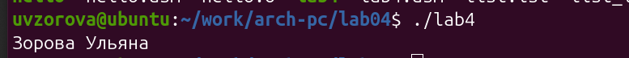{#fig-13 width=80%}

# Вывод

В ходе проделанной работы я получила практические навыки написания, компиляции и сборки программ на ассемблере NASM, а также закрепила знания о работе с командной строкой Linux.
